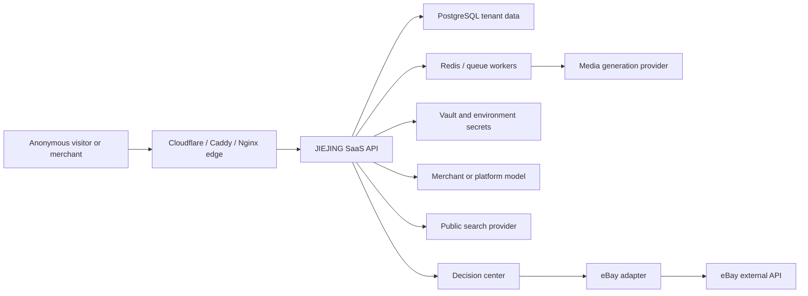

# JIEJING adversarial security review

Review date: 2026-07-11

Scope: the public SaaS entry points, AI CEO chat and web grounding, account-scoped model configuration, Listing handoff, media generation/rework, batch workflows, queue recovery, authentication, tenant boundaries, and the public staging reverse-proxy path.

This review assumes a public multi-tenant service using Cookie or Bearer authentication, PostgreSQL and Redis in production, merchant BYOK, external search/media providers, and confirmation-gated eBay actions. Real eBay writes and paid commercial launch are currently disabled. The attacker may be an anonymous bot, a normal tenant, a tenant with a stolen session, or a malicious public web source. Cloud or host administrator compromise is out of scope.

## Executive result

No confirmed Critical issue was found. The initial review identified two High and seven Medium/Low issues. The remediation status below is the current source of truth; remaining external verification and production-runtime work still blocks unrestricted public trial and paid launch. Current confirmation gates and disabled real writes materially reduce impact, but they are not substitutes for cost, account-data, availability and answer-integrity controls.

## Remediation progress (2026-07-11)

- A-01 core backend remediation implemented: trusted proxy chains are parsed from the right-most trusted hop, rate-limit buckets are shared through the SaaS database, raw IP/email values are hashed, expired buckets are pruned, bounded process fallback remains available, and registration has stricter per-IP/global limits. Verified email and a real Turnstile/email challenge are still required before unrestricted platform-funded trials.
- A-02 remediated: media rework now enforces provider-job quota, ignores client billing idempotency keys, caps asset versions, and uses an expiring database reservation so concurrent retries enqueue at most one provider job.
- A-03 materially remediated: signed sessions now carry a `jti`, are registered server-side, and are immediately revoked on logout. Short access-token plus rotating-refresh architecture remains a paid-launch hardening item.
- A-04 remediated: cross-device chat writes use a persisted merge score and conditional UPSERT, so a poorer concurrent turn cannot overwrite a richer completed turn.
- A-05 mitigated: public source instructions are removed, source records are marked untrusted and factual-extraction-only, and prompt rules prohibit source content from changing tools, memory, routing, confirmation gates or actions.
- A-06 partially remediated: the edge and API now share a 1 MiB body limit, slow bodies time out, and oversized bodies are rejected without draining. Replacing `ThreadingHTTPServer` remains open.
- A-07 remediated for known credential families: nested text values are scanned even under ordinary field names before persistence/provider dispatch.
- A-08 and A-09 remain open. Registration/login enumeration reduction and removal of CSP `unsafe-inline` are still required before paid launch.

## System and trust boundaries

Primary assets:

- Merchant identity, company membership, store metadata, chat history, Listing drafts, source records, work records, and confirmation records.
- BYOK model credentials, eBay tokens, media/search provider credentials, session signing secret, and payment provider credentials.
- Platform-funded model/media quota and external provider spend.
- Integrity of AI CEO advice, market reports, Listing facts, and confirmation decisions.
- Availability of the API, queues, workers, database, and public SaaS workflow.

Primary trust boundaries:

- Browser to edge, edge to API, API to data stores, API/worker to external providers, untrusted web content to model context, and draft output to the decision center.
- Tenant scoping is enforced with `company_id`; account-scoped BYOK additionally uses the current user identity. Secrets remain on the backend.

## Prioritized findings

| ID | Severity | Dimension | Finding and evidence | Impact | Required improvement |
| --- | --- | --- | --- | --- | --- |
| A-01 | High | Abuse / availability | Rate limits use process-local dictionaries and the first `X-Forwarded-For` value (`jiejing_saas/api_server.py:4062-4134`, `4572-4578`). The Nginx route appends forwarded values (`deploy/nginx.public-staging.conf:95-106`), while only one edge variant explicitly overwrites the header (`deploy/Caddyfile.route-a-edge:17-27`). Registration is public and activates a trial (`api_server.py:1141-1185`). | A spoofable or inconsistently sanitized client IP can bypass login, registration, and expensive-route limits. Rotating IP/email keys also grows in-memory buckets and enables account/trial farming, model-cost abuse, and process memory pressure. | Trust forwarded headers only from named proxies and overwrite them at every public edge. Move limits to Redis with TTL and bounded cardinality, keyed by IP, account, email and route. Require email verification before platform-funded AI, add bot/device risk checks, and alert on registration or model-usage spikes. |
| A-02 | High | Cost abuse / boundary | Initial provider jobs require `provider_job` quota (`api_server.py:2493-2497`), but `POST /media-asset-jobs/{id}/retry` checks only `create_task` and accepts a client-controlled idempotency seed (`api_server.py:3231-3284`). Current readiness reports live media provider calls are allowed. | A tenant can repeatedly create rework versions with fresh keys and bypass the billing/provider-job quota, causing external provider spend and queue pressure. | Apply quota and cost-budget reservation atomically before every retry. Generate billing idempotency server-side from root job, parent version and normalized spec. Cap versions per root asset and daily account spend; release or settle reservations on terminal worker state. |
| A-03 | Medium | Session theft / recovery | The default session lasts seven days and is a stateless HMAC payload without `jti`, session version, issuer or audience (`jiejing_saas/security.py:49-96`). Logout only expires the browser cookie (`api_server.py:1208-1212`). | A copied Cookie/Bearer token remains usable until expiry after logout, password reset, device loss or a security incident. | Use 15-30 minute access tokens plus rotating refresh sessions stored server-side. Add `jti`, issuer, audience and `token_version`; revoke sessions on logout, password reset, role change and security events. Show active devices and support one-click revocation. |
| A-04 | Medium | Concurrency / data integrity | Cross-device chat merge reads the current row, compares merge scores, then performs an unconditional upsert (`jiejing_saas/repository.py:3154-3220`). | Two concurrent devices can both read the old state and the poorer last writer can overwrite a richer completed turn, despite sequential tests passing. | Persist merge score/revision and use a conditional PostgreSQL upsert, row lock, or compare-and-swap. Add a real concurrent PostgreSQL test with two transactions and deterministic winner assertions. |
| A-05 | Medium | Malicious content / AI integrity | Public search snippets are inserted into `web_context.source_records` and sent to the model (`jiejing_saas/ai_ceo_chat.py:877-898`, `961-980`). Current rules demand citations and fact boundaries but do not explicitly classify or isolate prompt-injection text from source snippets. | A malicious page can place instructions in a snippet and bias recommendations, policy summaries or Listing drafts. Confirmation gates prevent direct writes, but merchants can still receive manipulated advice. | Treat every source field as untrusted data. Strip or flag instruction-like text, perform structured fact extraction before synthesis, require independent corroboration for strong claims, and prevent web content from changing tool selection, memory policy, confirmation state or action plans. |
| A-06 | Medium | Extreme input / availability | The API uses `ThreadingHTTPServer` and blocking reads. It reads the declared body length without an application socket timeout and drains up to about 1 MiB before rejecting oversized JSON (`api_server.py:312`, `5307-5327`). The public Nginx config has a 10 MiB edge limit and 300-second proxy timeouts (`deploy/nginx.public-staging.conf:9`, `95-107`). | Slow clients or many partially sent requests can occupy threads and connections. Large edge allowance also exceeds the API contract and wastes bandwidth before rejection. | Enforce a 1 MiB body limit at the first public edge, set short header/read/idle timeouts and connection limits, and run the API under a hardened multi-process WSGI/ASGI server. Close oversized requests at the edge instead of draining them in application code. |
| A-07 | Medium | Secret handling / malicious input | Generic recursive redaction masks values only when dictionary keys contain `secret`, `token`, `password`, or `api_key` (`jiejing_saas/api_server.py:6244-6256`). Chat history has stronger text sanitization, but generic provider inputs can carry a credential under an innocent key such as `notes`. | A merchant can accidentally persist or send a credential to a model/media provider, audit record or worker payload even though the intended secret boundary is backend-only. | Apply value-pattern secret detection to every free-text and nested provider input before persistence or dispatch. Reject likely credentials and direct the merchant to the secure connection form; do not rely only on masking key names. |
| A-08 | Low | Enumeration | Login returns before password hashing when an email does not exist (`jiejing_saas/repository.py:489-500`), and registration returns an explicit conflict for an existing email (`api_server.py:1175-1177`). | Timing and response differences can help enumerate registered merchant emails, especially if A-01 is not fixed. | Run a fixed-cost dummy hash for unknown users, use less distinguishable public responses, and keep precise reasons only in backend audit logs. |
| A-09 | Low | Browser defense in depth | Public pages currently permit inline scripts/styles in CSP. Cookies are `HttpOnly`, `SameSite=Lax`, and `Secure` on HTTPS (`api_server.py:4028-4050`). | Existing escaping and safe-rendering guards reduce XSS risk, but `unsafe-inline` weakens CSP if a DOM injection is introduced later. | Move inline scripts to versioned static files or use nonces/hashes. Add Trusted Types after the current rendering paths are compatible. Keep HSTS enforced at the public edge. |

## Adversarial scenarios

### Extreme input

- Oversized JSON is capped in the API, but the edge permits more and slow body delivery can hold a thread.
- User-controlled chat, source snippets, Listing text, media prompts and nested provider payloads need one shared size, encoding and secret-pattern policy.
- Add tests for invalid UTF-8, deeply nested JSON, huge strings, repeated Unicode combining characters, malformed URLs, prompt-injection phrases, and image/video metadata bombs.

### Concurrency and idempotency

- Queue heartbeat and stale-job recovery tests are present, but idempotency must cover billing reservation, provider submission and terminal result as one state machine.
- Cross-device chat merge needs database-level conflict resolution, not a read-then-write decision in application code.
- Add simultaneous submit/retry/cancel tests, duplicate webhook tests, worker death after provider acceptance, and database failover between reservation and enqueue.

### Boundary failures

- No confirmed cross-tenant IDOR was found in the reviewed paths; store and job lookup generally include `company_id`.
- Account BYOK and company/store data must remain separate: user model credentials follow the account, while eBay stores and business records remain company-scoped.
- Every new endpoint must prove tenant scope, permission, quota, idempotency and audit behavior in one contract test.

### Failure recovery

- The queue has heartbeat and stale-recovery coverage, but media retries can currently create new cost-bearing work without the original quota gate.
- External provider timeout must resolve into one of: safe retry with the same provider idempotency key, manual review, or terminal failure. It must never silently create a second billable generation.
- Search/model degradation should preserve the merchant request, show a concise retry state, and never convert an unverified answer into a market report or Listing fact.

### Malicious abuse

- Anonymous trial farming, credential stuffing, account enumeration and high-cost endpoint flooding are the most immediate public risks.
- Authenticated abuse includes media rework loops, prompt injection through supplied links, secret pasting into normal fields, and deliberately malformed Listing/media jobs.
- Confirmation gating remains mandatory for real publish, price, inventory, advertising, refunds, payments, policy edits and sensitive customer promises.

## Existing controls that tested well

- Real eBay writes and paid launch remain disabled; high-risk actions stop at the decision center.
- Tenant-scoped repository access and permission checks are consistently used in the reviewed merchant paths.
- Production model base URLs are restricted to approved provider hosts, reducing BYOK SSRF risk.
- Media downloads use an allowlist and provider credentials stay in Vault/environment boundaries.
- JSON has an application-level size cap; cookies use `HttpOnly` and `SameSite=Lax` and become `Secure` behind HTTPS.
- AI CEO source citations, eBay policy wording checks, Listing fact boundaries, secret scan, queue heartbeat recovery, bulk partial-success handling and cross-device history tests currently pass.

## Remediation order and acceptance gates

### P0 before broad public trial or live media spend

1. Fix A-01 with edge header normalization plus Redis distributed limits. Prove spoofed `X-Forwarded-For` cannot change the effective client identity and that keys expire.
2. Fix A-02 with atomic quota/cost reservation on retry. Prove 100 concurrent retries for one asset produce at most one billable provider submission.
3. Require verified email before platform-funded model quota. Keep merchant BYOK outside the platform-funded trial counter.

### P1 before paid launch

1. Add revocable short-lived sessions for A-03.
2. Implement database-level merge/CAS for A-04.
3. Add untrusted-source extraction and injection tests for A-05.
4. Align edge/body/timeouts and production server runtime for A-06.
5. Extend secret-pattern rejection for A-07.

### P2 hardening

1. Reduce account-enumeration signals.
2. Remove CSP `unsafe-inline` and add browser security regression tests.
3. Add abuse telemetry: registration velocity, failed login distribution, platform-model usage, media spend reservations, retry fan-out, queue age, provider duplicate IDs and tenant-scope denials.

## Readiness conclusion

The product workflow is materially closer to a mature SaaS, but it is not ready for unrestricted public trial, live media spend at scale, or paid commercial launch until P0 is complete and adversarial tests pass. The current honest state remains beta-capable with real actions confirmation-gated; it must not be presented as production-ready for real customers.
